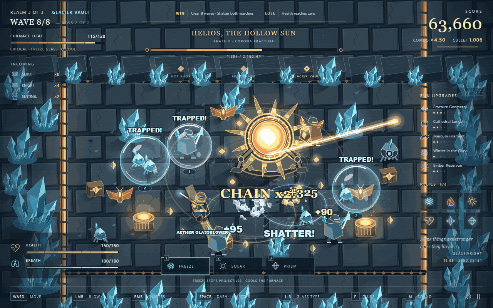

# Aether Blowpipe: Glacier & Furnace

[](https://make.fun/bounty/best-game-01)
[](https://make.fun/bounty/best-game-01)
[](https://make.fun/bounty/best-game-01)

**Breathe glass. Capture chaos. Shatter the sun.**

An original offline action roguelike about the last alchemical glassblower inside a frozen foundry. Contain living enemies in elemental glass, place a chain, then break it at the right moment. Cold keeps you safe; heat makes you dangerous.



## Play

Requires Node.js 22.18 or newer and a desktop browser.

```sh
node serve.ts
```

Open **http://127.0.0.1:5188**. No install or build is needed to play. Any static HTTP server serving `game/` also works. The game makes no network requests and uses no external fonts, images, sound files or libraries.

| Input | Action |
| --- | --- |
| WASD / arrow keys | Move |
| Mouse | Aim |
| Hold left mouse | Grow elemental glass; release to leave it floating |
| Right mouse | Shatter all glass; nearby spheres amplify one another |
| Space | Invulnerable dash and shatter |
| 1 / 2 / 3 | Freeze / Solar / Prism; choose a refit at the forge |
| P / Escape | Pause |
| M | Toggle sound |
| Enter | Start or retry |

## The descent

Three realms, eight waves, two wardens. The Hot Shop introduces pursuit and containment. The Frost Yard adds ranged enemies, charging knights and the Rime Regent. The Glacier Vault mixes all five creature families before Helios, the Hollow Sun, opens its second phase.

- **Freeze:** cools the furnace, slows prey and blocks incoming projectiles.
- **Solar:** greater impact and armor pressure, at the cost of furnace heat.
- **Prism:** extended blasts, echoes and elemental combinations.
- **Thermal Shock:** combine Freeze and Solar to fracture a primed target harder.
- **Cold Refraction:** Frozen targets extend Prism blast radius.
- **Sun Dog:** Solar and Prism spread a burn through nearby creatures.
- **16 refits:** combine breath, mobility, heat control, sustain and fracture power. Brittle Covenant trades maximum health for damage.
- **12 relics:** six carried slots, earned from realm milestones or bought with salvaged cullet. Each changes a real combat or recovery rule.
- **Traveling forge:** choose one free refit per wave, reroll offers, buy a relic, mend health or temper furnace capacity.
- **Permanent workshop:** mastery unlocks four starting tools with distinct trade-offs. Eight milestones record discoveries. All progression saves locally.
- **Three difficulties:** Apprentice, Glasswright and Inferno alter enemy counts, damage, thermal pressure and scoring.

Heat causes damage when the furnace overflows. Zero health ends the run. Boss beams announce their path before firing; physical crystal pillars and small furnaces intercept fire. Supply crates contain salvage and breath. Leaving a trapped creature too long lets it escape.

## Original art and sound

The custom 2.5D renderer paints beveled stone masonry, inlaid foundry sigils, glacial growth, brass fixtures, crafted characters, long cast shadows, iridescent glass and additive light. Static architecture is cached; moving creatures and effects share one painter-sorted rendering path. Original Web Audio synthesis supplies glass harmonics, impacts, breath, forge bells and a sequenced foundry soundscape. Sound unlocks after a user gesture; mute and reduced camera motion are available in pause.

All art, gameplay, writing and audio were authored for this entry. The sole runtime-independent vendor file is the unmodified official make.fun dossier builder, required by the bounty.

## Reproduce and test

Development tools only:

```sh
npm install
npx playwright install chromium
node --test tests/rules.test.mjs
node tests/full-run.mjs
npm test
npm run capture
```

Keep `node serve.ts` running during browser tests. Set `CHROME_PATH` if using an existing browser, or `GAME_URL` for another server origin. `tests/full-run.mjs` drives the simulation through input intents without changing combat statistics. Browser tests separately exercise actual keyboard and pointer input, capture, damage, pause, forge, boss phases, defeat and restart.

`npm run capture` uses PNG palette compression only, retaining the complete 1280 × 800 viewport. Source screenshots stay untouched in ignored `artifacts/raw/`. The four dossier images are ordered:

1. `01-combat.png` — late-run combat cover, wave eight, trapped enemies and a glass chain.
2. `02-title.png` — title, elements, difficulties and realm route.
3. `03-upgrade.png` — forge refit choices and merchant services.
4. `04-gameover.png` — victory, S rank, statistics, final build and restart.

The `?shot=combat`, `?shot=title`, `?shot=upgrade` and `?shot=victory` URLs are curated deterministic run snapshots rendered by the actual game. They are not evidence of a human playing those precise runs. The browser tests and intent bot provide the separate gameplay evidence. Test-only introspection is gated by `?qa`; normal play starts on the title screen.

## Dossier entrypoint

`main.ts` uses only the Node standard library and `vendor/makefun-game.ts`. It copies the static game and screenshots into the grader's output directory, then writes the official deterministic dossier bytes. No dependencies are installed by the grader.

```sh
# Linux/macOS
MAKEFUN_OUTPUT_DIR=out node main.ts
```

```powershell
# PowerShell
$env:MAKEFUN_OUTPUT_DIR = "out"
node main.ts
```

Without the environment override, the grader's `/output` directory is used. The submission deliberately stops before `makefun submit` pending visual audit.

## Source map

| Module | Responsibility |
| --- | --- |
| `simulation.js` | Fixed-step combat, waves, collision, capture, shatter and bosses |
| `navigation.js` | Obstacle-aware A* steering and path caching |
| `element-reactions.js` | Element priming, mixed-glass reactions and burns |
| `content.js` | Element, creature, refit and relic definitions |
| `workshop.js` | Persistent mastery, tool unlocks and milestones |
| `forge-services.js` | Merchant economy and service validation |
| `art.js` | Original stone, crystal, character and boss drawing |
| `renderer.js` | Layered arena rendering, glass, trails and effects |
| `interface.js` / `icons.js` | Menus, live HUD, codex and vector icon system |
| `audio.js` | Event-driven original synthesis and sequenced music |
| `scenes.js` | Deterministic editorial screenshot states |
| `boot.js` | Input, fixed-step loop, scaling and gated QA hooks |

MIT licensed. Built for [make.fun — Make the best game](https://make.fun/bounty/best-game-01).
